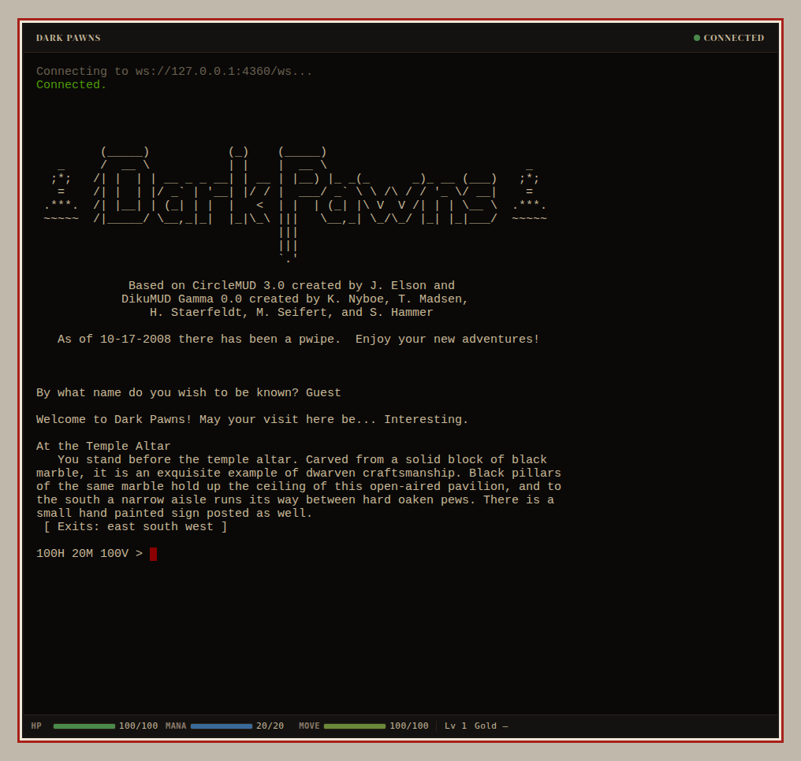
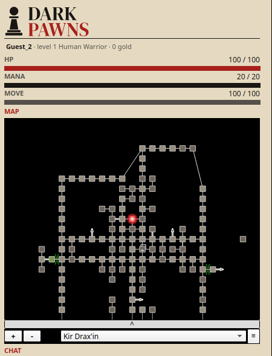
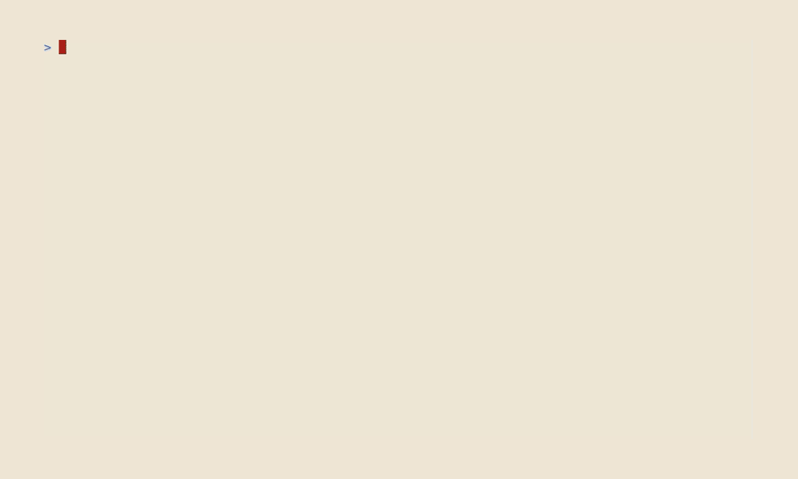
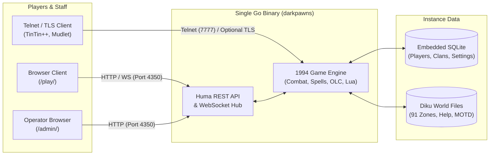
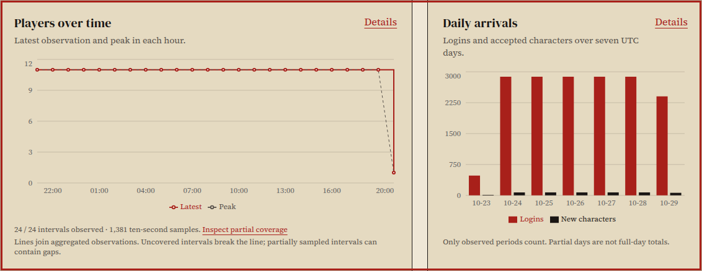
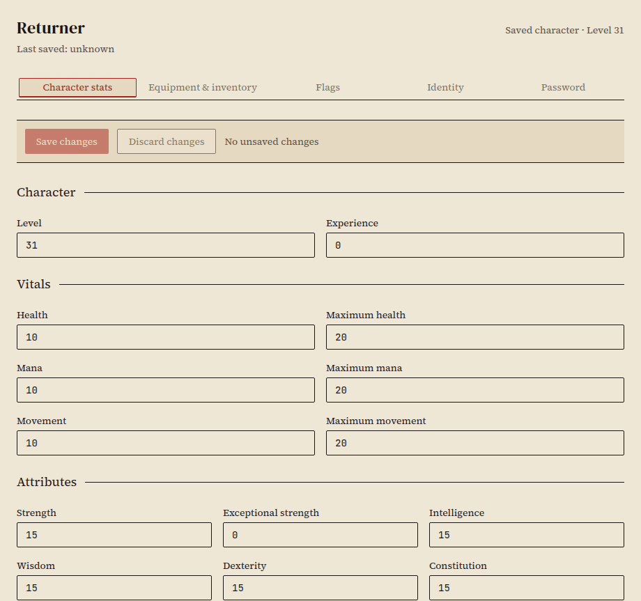
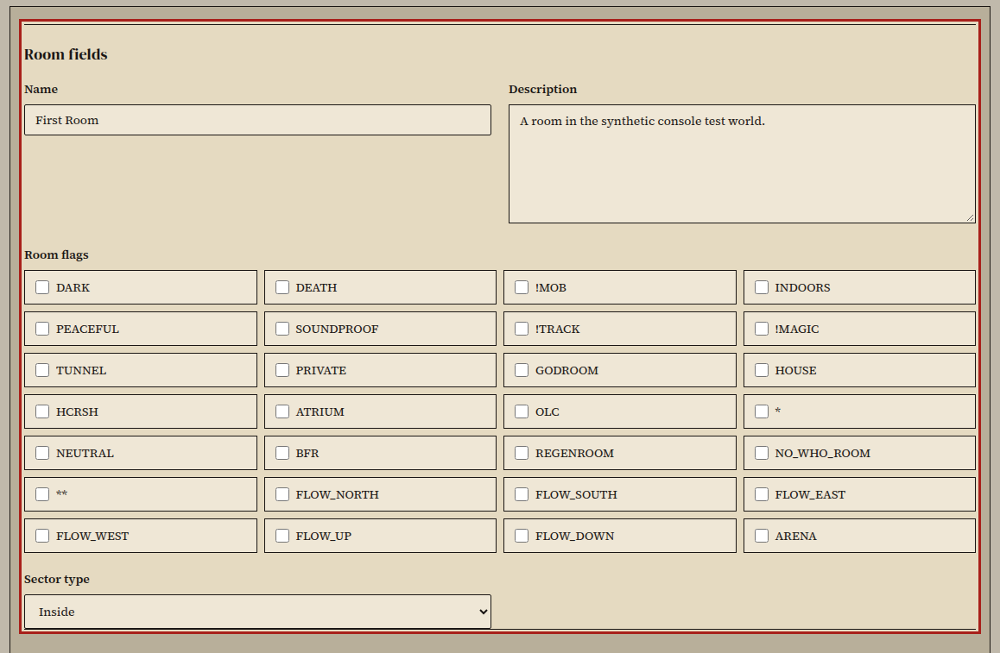
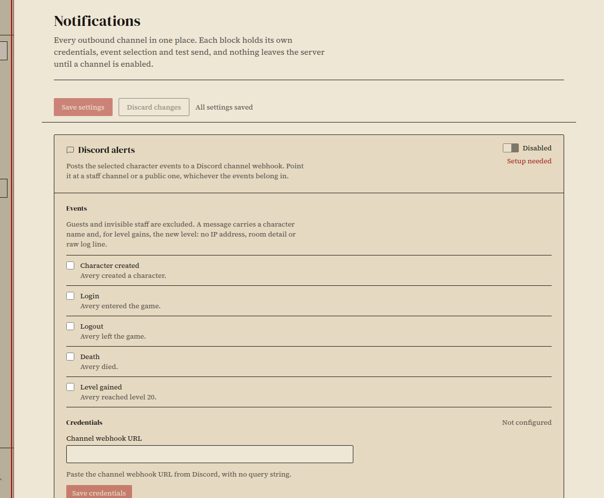
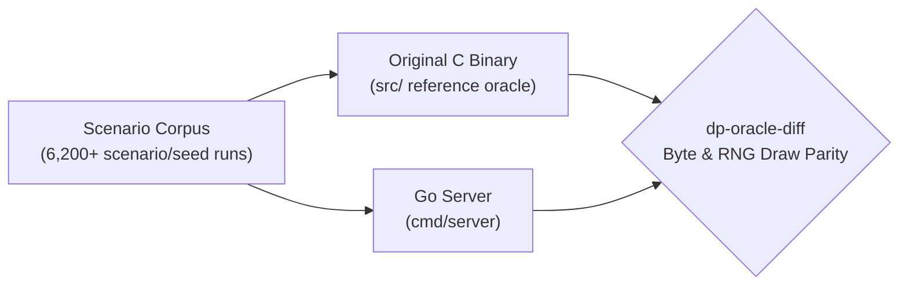

[](https://github.com/zax0rz/darkpawns/actions/workflows/ci.yml)
[](https://github.com/zax0rz/darkpawns/releases/latest)
[](go.mod)
[](https://huma.rocks/)

[](https://discord.gg/supVzU9yN)
[](LICENSE)

```
        (_____)           (_)    (_____)
  _     /  __ \           | |    |  __ \                            _
 ;*;   /| |  | | __ _ _ __| | __ | |__) |_ _(_      _)_ __ (___)   ;*;
  =    /| |  | |/ _` | '__| |/ / |  ___/ _` \ \ /\ / / '_ \/ __|    =
.***.  /| |__| | (_| | |  |   <  | |  | (_| |\ V  V /| | | \__ \  .***.
~~~~~  /|_____/ \__,_|_|  |_|\_\ |||   \__,_| \_/\_/ |_| |_|___/  ~~~~~
                                 |||
                                 |||
                                 `.'
```

# Dark Pawns MUD

**A 1994 CircleMUD 3.0 world, ported 1:1 to a single Go binary.** Dark Pawns is a multiplayer text RPG in the DikuMUD lineage: 91 zones, six base classes, remort classes, clans, Death Traps, and a world outside the city walls that does not care you are level 1.

This repository replaces the 1990s C server with a self-contained Go binary that emits the exact same player-facing bytes as the original, while adding an embedded SQLite database, a browser client, a full web admin console, and a browser-based world editor (webOLC). Play on the public server at [darkpawns.org](https://darkpawns.org), or spin up your own world on Linux, macOS, or Windows in under a minute.

[**Play in your browser**](https://darkpawns.org/play/) · [**Documentation**](https://darkpawns.org/docs/) · [**World Map**](https://darkpawns.org/map/) · [**Mob & Item Database**](https://darkpawns.org/database/) · [**Discord**](https://discord.gg/supVzU9yN)

> *Like a great game of chess, the world has become a board filled with bishops and kings, stately queens, white knights and dark pawns striving to rise through the ranks into godhood.*
>
> R.E. Paret (Frontline), `lib/text/background`

## Play now

No account signup and no download required. Jump straight into the browser at **[darkpawns.org/play](https://darkpawns.org/play/)**, or point your favorite MUD client at **`darkpawns.org` port `7778` (TLS)** or **`7777` (classic telnet)**.

| Browser Client (`darkpawns.org/play`) | Mudlet Desktop Client (`darkpawns.org:7778`) |
| --- | --- |
|  |  |
| Zero install, built-in vitals bar, and one tab per character. | Connects over TLS and auto-installs a GMCP dock with vitals, a live room map, and a chat pane. |

```sh
# In TinTin++:
#ssl {first} {darkpawns.org} {7778}

# Or from any terminal with OpenSSL:
openssl s_client -quiet -connect darkpawns.org:7778
```

> [!TIP]
> **Bring a party (even if all three of them are you).** Dark Pawns lets you play up to three characters at once (`help MULTI`). A level 1 character can trade punches with a level 1 guard trainee, but by level 15 a solo adventurer is mostly dragon food. See [Your first hour](https://darkpawns.org/docs/play/first-hour/), [Connect a client](https://darkpawns.org/docs/play/connect-client/), and [Color](https://darkpawns.org/docs/play/color/) to get started.

## Host your own world in 60 seconds

One command verifies the release signature and SHA-256 checksum, installs under your user account (no `sudo`, compiler, or runtime needed), and starts the interactive setup wizard.

**Linux and macOS:**

```sh
curl -fsSL https://darkpawns.org/install.sh | bash
```

**Windows (PowerShell 5.1+):**

```powershell
$installer = Join-Path ([IO.Path]::GetTempPath()) ('darkpawns-' + [Guid]::NewGuid().ToString('N') + '.ps1'); try { Invoke-WebRequest -UseBasicParsing 'https://github.com/zax0rz/darkpawns/releases/latest/download/install.ps1' -OutFile $installer; & powershell.exe -NoProfile -ExecutionPolicy Bypass -File $installer; if ($LASTEXITCODE -ne 0) { throw 'Installer did not complete.' } } finally { Remove-Item -LiteralPath $installer -ErrorAction SilentlyContinue }
```

**Package managers and containers:**

```sh
# Homebrew (macOS and Linux)
brew install darkpawns/tap/darkpawns && darkpawns setup

# Scoop (Windows)
scoop bucket add darkpawns https://github.com/darkpawns/scoop-bucket && scoop install darkpawns && darkpawns setup

# Docker
docker run --rm -it -p 127.0.0.1:4350:4350 -p 127.0.0.1:7777:7777 ghcr.io/darkpawns/darkpawns:latest
```



> [!IMPORTANT]
> **Claim your Implementor before opening the gates.** On a fresh database, the very first character you roll in the web client (`http://127.0.0.1:4350/play/`) or over telnet (`localhost 7777`) is automatically promoted to **Level 40 (`IMPL`)** and granted full access to `/admin/`. Every character after the first starts as a level 1 mortal. A new install binds to `127.0.0.1` by default so nobody can snipe godhood while you're making coffee.

Once installed, the `darkpawns` CLI handles the lifecycle (`status`, `start`, `stop`, `restart`, `doctor`, and signed in-place `update`). Read the [Install guide](https://darkpawns.org/docs/host/install/), [Your first login](https://darkpawns.org/docs/host/first-login/), and [Update your server](https://darkpawns.org/docs/host/update-server/) for the full walkthrough.

## What ships in the box

A fresh server starts in under half a second and idles around 85 MiB of RAM. One process serves the classic MUD, the web client, the React admin console, and an OpenAPI-documented REST surface backed by embedded SQLite.



| Admin Dashboard & Live Logs | Player & Equipment Editor |
| --- | --- |
|  |  |
| Watch who's online, inspect recent mortal deaths (and what killed them), and tail or export server and in-game logs. | Edit levels, stats, flags, and every equipment slot in the browser while the character is offline. |
| **Browser World Builder (webOLC)** | **Pushover, Discord & Heartbeat Alerts** |
|  |  |
| Edit rooms, objects, mobs, zones, and Lua triggers with draft leases, or build in-game with `redit`, `oedit`, `medit`, `zedit`, and `sedit`. | Route logins, deaths, and level-ups to Discord or Pushover, and ping a [Healthchecks.io](https://healthchecks.io) dead-man's switch every minute. |

## The Fidelity Law: "The game is the game"

Most ports "fix" the old game on the way over. Dark Pawns treats any change to player-observable behavior as a bug.

The original C source in [`src/`](src/) is our read-only oracle. Under the [Fidelity Rulebook](https://darkpawns.org/docs/project/port-fidelity/) (R1 through R5), the Go server must emit the exact same bytes, preserve every command and quirk (down to `who` printing raw `&r` tags when ANSI color is off, and `DEATH` rooms wiping your inventory without a saving throw), and advance the random number generator in lockstep with the C binary.



Before a release ships, `cmd/dp-oracle-diff` drives both engines through more than six thousand scenario and seed runs, verifying every output byte and every RNG draw.

## Documentation & Developer Quickstart

Full documentation lives at **[darkpawns.org/docs](https://darkpawns.org/docs/)** (with clean `.md` twins at every URL and [`llms.txt`](https://darkpawns.org/llms.txt) for agents):

| Section | What's inside |
| --- | --- |
| [**Play**](https://darkpawns.org/docs/play/) | [Your first hour](https://darkpawns.org/docs/play/first-hour/), [Connect a client](https://darkpawns.org/docs/play/connect-client/), and [ANSI Color levels](https://darkpawns.org/docs/play/color/). |
| [**Host**](https://darkpawns.org/docs/host/) | [Hosting overview](https://darkpawns.org/docs/host/hosting-overview/), [Install](https://darkpawns.org/docs/host/install/), [First login](https://darkpawns.org/docs/host/first-login/), [Admin console](https://darkpawns.org/docs/host/admin-console/), [Player management](https://darkpawns.org/docs/host/player-management/), [Updates](https://darkpawns.org/docs/host/update-server/), and [Troubleshooting](https://darkpawns.org/docs/host/players-cannot-connect/). |
| [**Build**](https://darkpawns.org/docs/build/) | [Run a local server](https://darkpawns.org/docs/build/local-server/), and editing [Rooms](https://darkpawns.org/docs/build/edit-rooms/), [Objects](https://darkpawns.org/docs/build/edit-objects/), [Mobs](https://darkpawns.org/docs/build/edit-mobs/), [Zones](https://darkpawns.org/docs/build/edit-zones/), and [Lua scripts](https://darkpawns.org/docs/build/edit-lua-scripts/). |
| [**Reference**](https://darkpawns.org/docs/reference/) | [Glossary](https://darkpawns.org/docs/reference/glossary/), all [429 verbatim in-game help topics](https://darkpawns.org/docs/reference/commands/), and the [Public](https://darkpawns.org/docs/reference/api/public/) & [Admin](https://darkpawns.org/docs/reference/api/admin/) HTTP APIs. |
| [**Project**](https://darkpawns.org/docs/project/) | [Architecture](https://darkpawns.org/docs/project/architecture/), [Port fidelity](https://darkpawns.org/docs/project/port-fidelity/), [Contributing](https://darkpawns.org/docs/project/contributing/), and [Release notes](https://darkpawns.org/docs/releases/). |

To build and run the server directly from source:

```sh
git clone https://github.com/zax0rz/darkpawns.git
cd darkpawns
export JWT_SECRET="$(openssl rand -hex 32)"
go build -o server ./cmd/server && ./server
```

Before opening a pull request, read [`AGENTS.md`](AGENTS.md) and [`docs/fidelity/RULEBOOK.md`](docs/fidelity/RULEBOOK.md), install the pre-push hook (`make hooks`), and run `make fmt`, `go build ./...`, `go vet ./...`, `go test ./...`, and `golangci-lint run ./...`.

## Credits & License

Dark Pawns grew from the work of its original developers, world builders, and players. The preserved [in-game credits](lib/text/credits) honor CircleMUD 3.0 (Jeremy Elson) and its DikuMUD creators (Katja Nyboe, Tom Madsen, Hans Henrik Staerfeldt, Michael Seifert, and Sebastian Hammer). The [original C codebase](https://github.com/rparet/darkpawns) was published by R.E. Paret (Frontline). The Go restoration is maintained by [zax0rz](https://github.com/zax0rz) (Aiko / Aidan).

> [!CAUTION]
> **Strictly non-commercial.** Because Dark Pawns derives from CircleMUD 3.0 and DikuMUD, the entire combined work is bound by the [CircleMUD](LICENSE.CircleMUD) and [DikuMUD](LICENSE.DikuMUD) licenses: you may run, modify, and host it freely, but you may **never** charge players fees, accept donations, or take reimbursement for hosting costs under any circumstances. Standalone new code (web admin, tooling, website) is additionally MIT-licensed. See [`LICENSE`](LICENSE) for the full terms (and the story of the 1999 Usenet flamewar that made them necessary).
