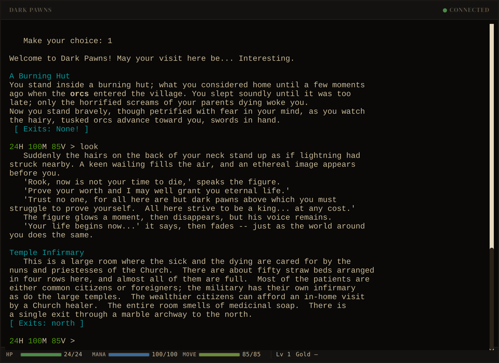
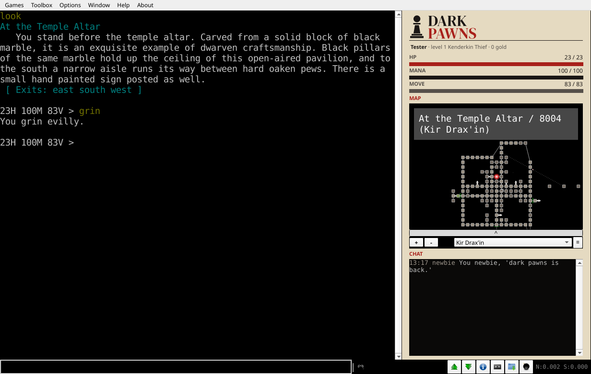
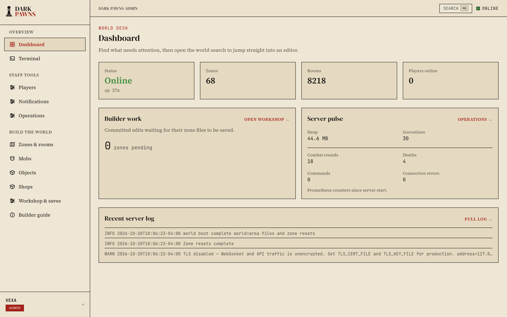
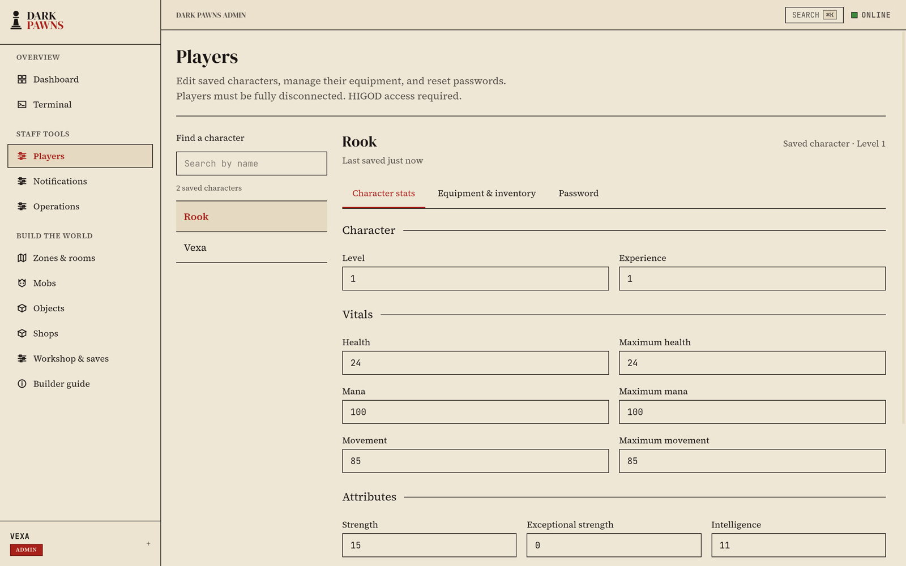
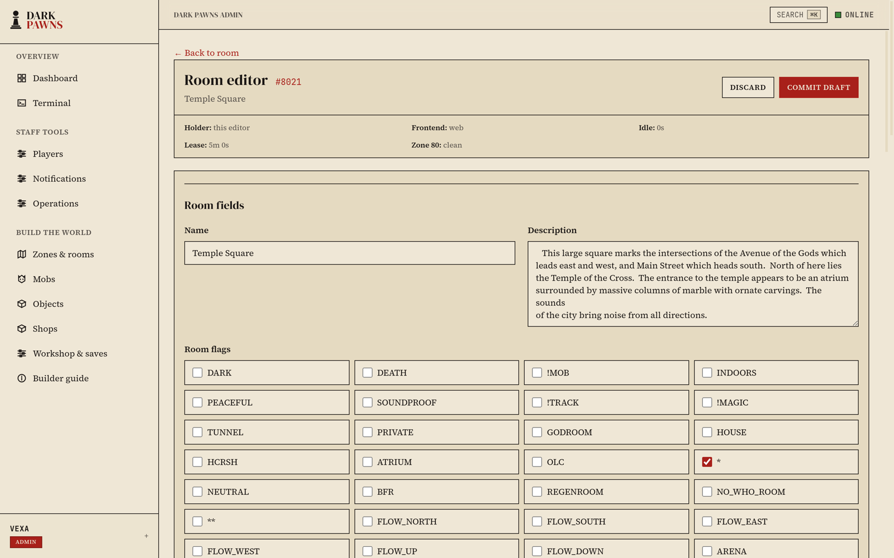
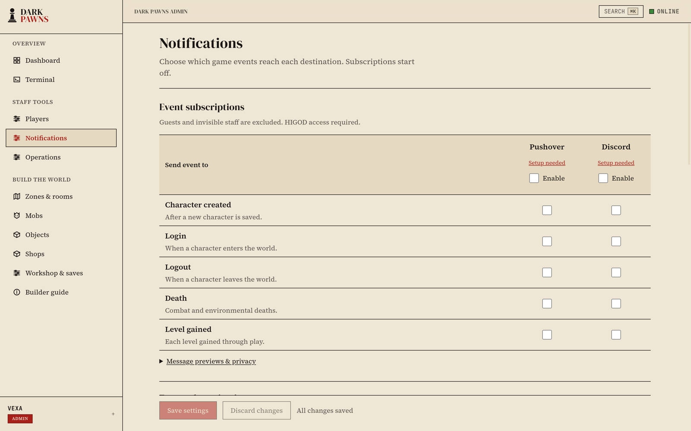
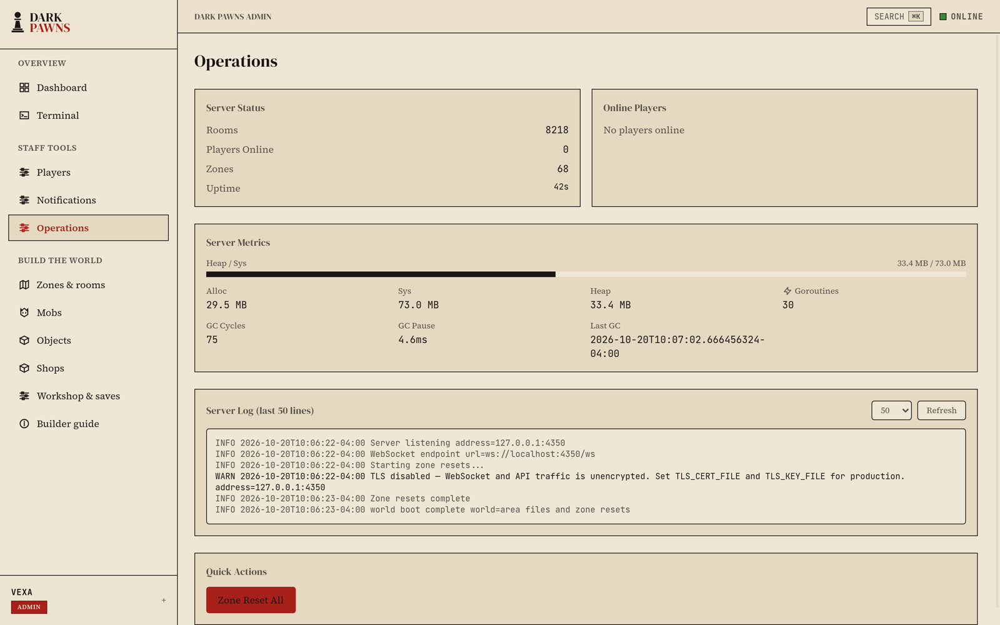

[](https://github.com/zax0rz/darkpawns/actions/workflows/ci.yml)
[](https://github.com/zax0rz/darkpawns/releases/latest)
[](go.mod)
[](https://huma.rocks/)

[](LICENSE)

```
        (_____)           (_)    (_____)
  _     /  __ \           | |    |  __ \                            _
 ;*;   /| |  | | __ _ _ __| | __ | |__) |_ _(_      _)_ __ (___)   ;*;
  =    /| |  | |/ _` | '__| |/ / |  ___/ _` \ \ /\ / / '_ \/ __|    =
.***.  /| |__| | (_| | |  |   <  | |  | (_| |\ V  V /| | | \__ \  .***.
~~~~~  /|_____/ \__,_|_|  |_|\_\ |||   \__,_| \_/\_/ |_| |_|___/  ~~~~~
                                 |||
                                 |||
                                 `.'
```
# Dark Pawns MUD

**CircleMUD 3.0, rewritten in Go.** Dark Pawns is a multiplayer text RPG in the
DikuMUD lineage, first opened in 1994. This repository ports its C server to a
single Go binary that emits the same player-facing bytes as the original. The
game runs live at [darkpawns.org](https://darkpawns.org), and one command
installs your own copy on Windows, macOS or Linux.

[Play in your browser](https://darkpawns.org/play) · [Install your own](#install) · [Website](https://darkpawns.org) · [Player guide](docs/player-guide/player-guide.md) · [Report a bug](https://github.com/zax0rz/darkpawns/issues)

## Install

Linux and macOS:

```sh
curl -fsSL https://darkpawns.org/install.sh | bash
```

Windows (PowerShell 5.1 or newer):

```powershell
$installer = Join-Path ([IO.Path]::GetTempPath()) ('darkpawns-' + [Guid]::NewGuid().ToString('N') + '.ps1'); try { Invoke-WebRequest -UseBasicParsing 'https://github.com/zax0rz/darkpawns/releases/latest/download/install.ps1' -OutFile $installer; & powershell.exe -NoProfile -ExecutionPolicy Bypass -File $installer; if ($LASTEXITCODE -ne 0) { throw 'Installer did not complete.' } } finally { Remove-Item -LiteralPath $installer -ErrorAction SilentlyContinue }
```


The installer checks the release's publisher signature and the archive's
SHA-256 before it extracts anything, installs under your user account, and
starts the setup wizard. No administrator rights, compiler or language runtime
are needed. Linux and macOS use the system's `curl`, `openssl` and `tar`;
Windows uses built-in PowerShell.

The wizard asks three things:

1. **A home for the world.** A new folder that holds your players, world edits
   and settings, kept apart from the release. Updates preserve it rather than
   replace it with the starter world.
2. **Connection and startup.** The local web port (default `4350`), whether to
   keep running after you close the terminal, whether to start when you sign in,
   and whether to open a browser.
3. **Review.** Nothing is created until you choose **Create and launch**. The
   default answer is Cancel.

When it finishes, open the printed address. **The first character you create
becomes the immortal** (level 40). Create it before you let anyone else connect;
every character after it starts as a mortal.

A new world listens on `127.0.0.1` only: the browser and admin console on the
web port, and telnet on `7777` (`telnet localhost 7777`; the wizard can change or
disable it). Nothing is reachable from other machines until you configure
hosting ([hosted instances](docs/portable-hosting.md)).

Prefer to do it by hand? Download your platform's archive from the
[latest release](https://github.com/zax0rz/darkpawns/releases/latest), extract
it, and run `darkpawns setup` (`darkpawns.exe setup` on Windows). The
[portable release guide](docs/portable-release.md) covers every option,
including `setup --plain` for screen readers and `setup --yes` for unattended
installs.

### If Windows or macOS refuses to open it

The installer verifies Dark Pawns' publisher signature and the archive's
checksum. Releases are not Apple-notarized or Windows Authenticode-signed, so
your operating system or local policy may still show a warning, particularly
for an archive downloaded with a browser. The vendors explain what the warnings
mean and how to open software you trust:

- **macOS:** [Safely open apps on your Mac](https://support.apple.com/102445)
  (Gatekeeper). On macOS 26.3, a copy installed by the one-line installer ran
  with no prompt. The same archive downloaded with a browser was blocked until
  approved under **System Settings → Privacy & Security → Open Anyway**;
  removing its quarantine attribute afterwards did not unblock it.
- **Windows:** [Microsoft Defender SmartScreen](https://learn.microsoft.com/windows/security/operating-system-security/virus-and-threat-protection/microsoft-defender-smartscreen).

If you skipped the installer, check the archive against the signed
`release-manifest.txt` before you open it. The
[portable release guide](docs/portable-release.md#manual-updates) shows how.

## Run your world

```sh
darkpawns status     # is it running, and where
darkpawns start      # start in the background; returns when it's ready
darkpawns stop       # save everyone and shut down cleanly
darkpawns restart    # stop, then start
darkpawns doctor     # check the release, instance, database and startup
```


Every command takes `--instance <folder>` for a world outside the default
location. `doctor` exits nonzero when it finds a problem, and `status --json` and
`doctor --json` give structured output for scripts.

To start the world when you sign in, choose it during setup or run
`darkpawns service install`. It registers a systemd user unit on Linux, a
LaunchAgent on macOS, or a Task Scheduler logon task on Windows, for your
account only. `darkpawns service remove` undoes it without touching the world.

The installer puts `darkpawns` in `~/.local/bin` on Linux and macOS. If your
shell can't find it, add that folder to your `PATH`. On Windows, open a new
terminal after installing.

## Update

```sh
darkpawns update --check    # download and verify the new release; the world keeps running
darkpawns update            # show the plan, then stop, back up, update and restart
```

Every update verifies the signed release first. When a new release is
available, a running world is stopped, its state is backed up, and it restarts
on the new release; a stopped world stays stopped, and an up-to-date one isn't
touched. If applying the update fails, the updater tries to restore the previous
release and snapshot by itself. If that can't finish, or the update was
interrupted, `darkpawns update recover` restores the previous snapshot. Offline
updates from an archive and the recovery details are in the
[portable release guide](docs/portable-release.md#manual-updates).
`darkpawns.org` itself updates with the same command.

## Play



The live game needs no account signup and no download: play in the browser at
[darkpawns.org/play](https://darkpawns.org/play), or connect any MUD client to
**`darkpawns.org` port `7778` with TLS**, so your password and everything you
type stay private.

In [TinTin++](https://tintin.mudhalla.net/):

```text
#ssl dp darkpawns.org 7778
```

With no client at all:

```sh
openssl s_client -quiet -connect darkpawns.org:7778
```

Port `7777` still answers clients without TLS, but everything sent there,
your password included, crosses the network in the clear. Keep it for a quick
look as a `guest`.

### Mudlet

[Mudlet](https://www.mudlet.org/) dresses itself for Dark Pawns. Make a profile
for `darkpawns.org`, port `7778`, with **Secure** ticked, and connect: before
the name prompt it installs a dock with your hit points, mana and movement, a
map of the whole world that follows you, and a chat window. The game text stays
byte for byte what every other client sees. The
[Mudlet guide](https://darkpawns.org/connect/#mudlet) covers the rest.



Returning from the 2004 era? The world files are the preserved originals, and
the port's prime directive is that the game plays byte for byte like the C
server did: same commands, same combat, same quirks. See
[the player guide](docs/player-guide/player-guide.md) for classes, character
creation, and how to connect.

## Administer

Every world includes an admin console at `/admin/`. Sign in with your
immortal's name and password.



### Players

Edit a saved character's level, experience, vitals and attributes, manage their
equipment and inventory, or reset their password. The character must be fully
disconnected first, so an edit never races the live game.



### Build the world (webOLC)

Edit rooms, mobs, objects, shops and zones from the browser. webOLC shares one
editor core with the classic in-game OLC, so it writes the same Diku-format
world files the server loads. Edits are drafts, held under a lease until you
commit them, and the workshop lists the zones with changes waiting to be saved.



### Notifications

Send game events to **Pushover**, **Discord** or both: character created, login,
logout, death and level gained. Pick events per destination under **Staff
tools → Notifications**, paste the provider credentials, and use the test
button. Changes take effect without a restart. Credentials are encrypted at
rest (AES-256-GCM) and never returned by the API. Delivery is best effort.



### Health checks

Three layers, from the inside out:

- **`darkpawns doctor`** checks the release files, instance configuration,
  file permissions, launcher, web client and startup registration. It runs the
  database integrity check only while the world is stopped.
- **`/health`** answers on the web port. Setup waits for it before it reports
  the world ready.
- **An external heartbeat.** Save a hosted [Healthchecks](https://healthchecks.io)
  ping URL (`hc-ping.com`) under Notifications. The game pings it once a minute
  while its main loop is making progress, and Healthchecks alerts you (by
  Pushover, email or whatever you connect there) when the pings stop, even if
  the whole host is down. Your check's period and grace time decide how soon.

**Operations** shows live status, memory and goroutine counts, who is online,
and the server log.



The [deployment guide](DEPLOYMENT.md#optional-game-notifications) covers key
storage, backups and outage detection.

## Build from source

The release is all you need to run Dark Pawns. To build the server yourself:

```sh
git clone https://github.com/zax0rz/darkpawns.git
cd darkpawns

export JWT_SECRET="$(openssl rand -hex 32)"

go build -o server ./cmd/server
./server
```

That's a running MUD. Connect with `telnet localhost 7777` or open
[http://localhost:4350](http://localhost:4350). On an empty database, the first
character you create becomes the immortal.

One binary, three surfaces: telnet (`-telnet-port`, default 7777), HTTP and
WebSocket (`-port`, default 4350, serving the browser client and a
[Huma](https://huma.rocks)-powered JSON API with OpenAPI at `/openapi.json`),
and an embedded SQLite database. `./server -h` lists every flag.
[Running Dark Pawns](DEPLOYMENT.md) covers database paths, reverse proxies,
backups and building the admin frontend. An operator-only PostgreSQL-to-SQLite
bridge remains for old instances; it is not part of the shipped server.

Official host access and deploy procedures for `darkpawns.org` live in a
private ops repository. The public guides cover operating *your* instance.

## What it is

- **The game:** combat, spells, skills, equipment, shops, clans, houses,
  bulletin boards and Lua scripting, ported from the original C with the
  original behavior as the reference implementation.
- **The fidelity contract:** the Go server must emit the same player-facing
  bytes as the C original. The [rulebook](docs/fidelity/RULEBOOK.md) is the
  law. A C-versus-Go differential harness (`cmd/dp-oracle-diff`) runs both
  servers through more than five thousand scenario and seed pairs, comparing
  every byte and every random-number draw, and per-command evidence manifests
  record what is proven. A system's presence here is not a claim that every
  branch is verified; check the fidelity records for coverage.
- **The operator surface:** portable releases with signed updates, the admin
  console, webOLC, notifications and health checks, a REST API with generated
  OpenAPI, WebSocket sessions, Prometheus metrics and audit logging.

## Repository layout

| Path | Contents |
| --- | --- |
| `cmd/server/` | Game server entry point |
| `cmd/darkpawns/` | Portable launcher: setup, lifecycle, doctor and update |
| `pkg/` | Game logic, sessions, transports, persistence, OLC and services |
| `cmd/dp-oracle-diff/` | C-versus-Go differential harness and scenarios |
| `lib/world/` | Preserved world files and scripts loaded by the server |
| `lib/text/` | Preserved game text and credits |
| `src/` | Original C source: read-only reference, never edited |
| `web/` | Browser game client and HTTP handlers |
| `admin-ui/` | React admin frontend, including webOLC |
| `website-astro/` | Authored Astro website ([darkpawns.org](https://darkpawns.org)) |
| `docs/` | Guides, fidelity evidence, research and history |

## Develop

Read [AGENTS.md](AGENTS.md) first for repository conventions and required
checks. [CONTRIBUTING.md](docs/CONTRIBUTING.md) covers the contribution
workflow, the fidelity contract and where help is wanted. Gameplay changes must
follow the [fidelity rulebook](docs/fidelity/RULEBOOK.md): player-facing bytes
are law, the C source wins disputes, and nothing is invented.

```sh
make hooks        # one-time: install the pre-push hook
make fmt          # gofumpt formatting (CI enforces it)
go build ./...
go vet ./...
go test ./...
golangci-lint run ./...
```

No commit without all four passing. The Go unit tests don't need the C oracle;
[development setup](docs/DEV-SETUP.md) covers the optional oracle harness.

Bug reports are most useful with the commands entered, what happened, and what
you expected. For fidelity work, verify the actual C call path and bring
evidence.

## Documentation

Start at the [documentation index](docs/README.md). Entry points:

- [Portable releases](docs/portable-release.md): install, run, update and recover
- [Hosted instances](docs/portable-hosting.md): put a world on a public server
- [Running Dark Pawns](DEPLOYMENT.md): server flags, proxies, notifications and backups
- [Fidelity rulebook](docs/fidelity/RULEBOOK.md): the port contract
- [Depth testing](docs/fidelity/DEPTH_TESTING.md): evidence and remaining work
- [Development setup](docs/DEV-SETUP.md): toolchain and oracle
- [Research notebook](docs/research/README.md): the open research artifact

Historical briefs and reports are preserved for context, not as a task queue.

## Credits and license

Dark Pawns grew from the work of its original developers, world builders and
players. The preserved [game credits](lib/text/credits) identify CircleMUD 3.0,
Jeremy Elson, and its DikuMUD foundations. The
[original C repository](https://github.com/rparet/darkpawns) was published by
R.E. Paret (Frontline). The Go port is maintained by
[zax0rz](https://github.com/zax0rz) (Aiko/Aidan).

Dark Pawns is a non-commercial hobby project. The game is derived from
CircleMUD 3.0 (Jeremy Elson), itself derived from DikuMUD (Staerfeldt, Nyboe,
Madsen, Seifert, Hammer), and those portions, including the Go port, are
subject to the [CircleMUD](LICENSE.CircleMUD) and [DikuMUD](LICENSE.DikuMUD)
licenses: strictly non-commercial, authors credited in-game, license texts
shipped with every copy. New original code (Go port authorship, web admin,
tooling, website) is MIT-licensed; where the licenses conflict, the
DikuMUD/CircleMUD terms govern the combined work. Run it and host it freely,
but never for money. See [LICENSE](LICENSE) for the full terms, including the
story of the 1999 Usenet thread that made it necessary.
