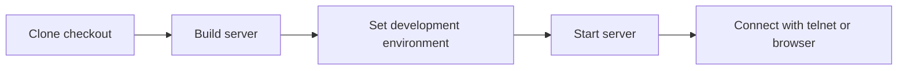

Build a disposable server from a Git checkout when you're working on the Go engine or testing world files. Unlike the 1999 C tree, you won't have to blow away `clan.c` to get the damn thing to compile: one `go build` gives you a self-contained binary with embedded SQLite, the original Diku world files, and the web client.

This flow shows how the checkout becomes a running local world.



## Before you start

- Install the Go version declared in [`go.mod`](https://github.com/zax0rz/darkpawns/blob/main/go.mod).
- No external database service. The server keeps player data in a single embedded SQLite file created on first boot (`lib/data/darkpawns.db` by default). Pass `-db` or set `DP_SQLITE_PATH` to put it somewhere else. PostgreSQL isn't a runtime backend: passing a `postgres://` address stops startup with an error.
- The repository's `lib/world/` directory, which holds the original rooms, mobs, objects, shops, and zones.

## Build

```bash
git clone https://github.com/zax0rz/darkpawns.git
cd darkpawns
go build -o server ./cmd/server
```

## Configure and start

Development mode can generate a temporary JWT secret on startup, which invalidates browser sessions every time you restart the binary. For repeatable local runs, generate a secret once with `openssl rand -hex 32` and export it in `JWT_SECRET`:

```bash
export ENVIRONMENT=development
export JWT_SECRET="<paste the 64 hex characters from openssl rand -hex 32>"
./server
```

When you run `./server` from the repository root, no flags are required: it reads the world from `lib/world`, serves the web client from `web/public`, and writes SQLite data to `lib/data/darkpawns.db`. To keep a scratch database outside `lib/data/`, pass `-db` or `DP_SQLITE_PATH`:

```bash
mkdir -p .local/development-world
./server -db .local/development-world/darkpawns.db
# or: export DP_SQLITE_PATH=.local/development-world/darkpawns.db
```

A boot that creates a brand-new database logs a warning so you can tell a fresh file apart from an existing world.

The HTTP and WebSocket server listens on `-port` (default `4350`); raw telnet listens on `-telnet-port` (default `7777`). Pass `-telnet-port 0` to disable raw telnet.

## Connect

```bash
telnet localhost 7777
```

The browser client runs at `http://localhost:4350/` and connects over `ws://localhost:4350/ws`.


The capture above comes from a disposable world on a test port; your local checkout uses `localhost:4350`.

## Did it work?

The startup log reports the listening ports, and connecting via telnet or `http://localhost:4350/` brings up the Dark Pawns login banner. The admin console lives on the same HTTP port at `http://localhost:4350/admin/`.

## If it didn't work

- **Startup rejects `JWT_SECRET`.** Generate 32 random bytes as hex (`openssl rand -hex 32`) and export the 64-character string without angle brackets.
- **The browser client can't connect.** Check the startup log for the HTTP port and the `/ws` WebSocket route; `-port` changes both.
- **Startup says the database is unavailable.** Unset `DP_ALLOW_NO_DB` and point `-db` at a writable directory.

## Verify a development checkout

Before committing any code change, format with `make fmt` and run the verification gates separately:

```bash
go build ./...
go vet ./...
go test ./...
golangci-lint run ./...
```

For C-oracle differential testing, see [Port fidelity workflow](/docs/project/port-fidelity/).

## No-persistence testing

:::caution[Oracle and harness use only]
Setting `DP_ALLOW_NO_DB=1` boots the server without a SQLite database. Character progress vanishes on logout, and systems that depend on stable character IDs (such as mudmail and houses) are disabled. Use it for the differential harness or quick throwaway tests, never for a world people play on.
:::
