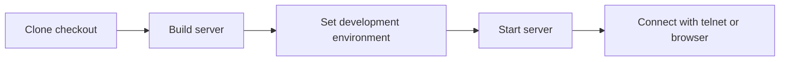

Build a disposable checkout to work on the game server or its world data. You’ll
have a local game server and can connect with telnet or the browser client.

This flow shows how the checkout becomes a running local world.



## Before you start

- Install the Go version declared in [`go.mod`](https://github.com/zax0rz/darkpawns/blob/main/go.mod).
- No database service. The server keeps everything in one embedded SQLite file, which it creates on first boot (by default `lib/data/darkpawns.db`, beside the world data). Pass `-db` or set `DP_SQLITE_PATH` to put it somewhere else. PostgreSQL isn't a runtime backend: a `postgres://` address stops startup with an error.
- The repository's `lib/world/` directory, which contains the original world files.

## Build

```bash
git clone https://github.com/zax0rz/darkpawns.git
cd darkpawns
go build -o server ./cmd/server
```

## Configure and start

Development mode can generate a temporary JWT secret. Tokens signed with it
stop working when the server restarts. For repeatable local restarts, generate
a secret once with `openssl rand -hex 32` and set the same string in
`JWT_SECRET` each time you start the server.

```bash
export ENVIRONMENT=development
export JWT_SECRET="<paste the 64 hex characters from openssl rand -hex 32>"
./server
```

Run from the repository root and no flags are needed: the world is read from
`lib/world`, the browser client is served from `web/public`, and the database is
created at `lib/data/darkpawns.db`. Name it explicitly to keep the database
in a separate writable directory for this checkout:

```bash
mkdir -p .local/development-world
./server -db .local/development-world/darkpawns.db
# or: export DP_SQLITE_PATH=.local/development-world/darkpawns.db
```

A boot that creates the database file logs a warning, so the startup log
distinguishes a new database from the one you expected it to open.

The HTTP and WebSocket server listens on `-port`; raw telnet uses `-telnet-port`. Pass `0` to disable the telnet listener.

## Connect

```bash
telnet localhost 7777
```

The browser client is served at `http://localhost:4350/` and connects over `ws://localhost:4350/ws`.


The capture uses a disposable local world on a separate port. Your checkout uses the address above.

## Did it work?

The server reports that it’s listening, and the telnet or browser client reaches
the login prompt. The browser client is served from the same HTTP port as the
admin console.

## If it didn’t work

- If startup rejects `JWT_SECRET`, generate 32 random bytes as hex with
  `openssl rand -hex 32` and export the result without angle brackets.
- If the browser client can’t connect, check the startup log for the HTTP port
  and the `/ws` WebSocket route; `-port` changes both.
- If startup says the database is unavailable, remove `DP_ALLOW_NO_DB` or point
  `-db` at a writable path. No-persistence mode is for temporary testing only.

## Verify a development checkout

```bash
go build ./...
go vet ./...
go test ./...
golangci-lint run ./...
```

The full C-oracle setup is covered in [Port Fidelity Workflow](/docs/project/port-fidelity/).

## No-persistence testing

`DP_ALLOW_NO_DB=1` lets the server start without a player database. Character
progress won't persist, and features that need stable player identity, such
as mail, are unavailable. Use this only for temporary development or the
oracle harness, never for a playable server.
