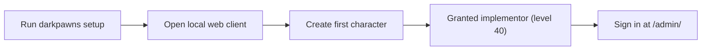

A fresh portable instance needs one game character before you can sign in to the admin console. The first character successfully created becomes the Implementor (level 40); setup doesn't create a separate admin account.

:::caution
Create the first character before you let other people connect. That character receives the highest staff access.
:::

## Before you start

- [Install Dark Pawns](/docs/host/install/).
- A terminal on the machine that will run the instance.

This flow shows how the first character created on a new world unlocks the admin console.

## Create an instance

1. Run `darkpawns setup`.
2. Choose the instance folder and local web and telnet ports.
3. Review the settings and let setup create and start the instance.

Setup prints the local web client address when the world is ready. The default is `http://127.0.0.1:4350/`; the default telnet listener is `127.0.0.1:7777`. Both bind to loopback, so another machine can't connect directly.

## Connect to the game

1. Open the web client at the local address printed by setup.
2. Create the first character. This character becomes the Implementor (level 40).

## Open the admin console

1. Open `/admin/` on the server's HTTP address.
2. Sign in with the Implementor character's name and password.

The admin console checks the character's current access level each time it makes an authenticated request. Some tools require level 40; [The admin console](/docs/host/admin-console/) lists each page's access gate.

## Did it work?

The first character has level 40, and `/admin/` opens the console for that character.

## If it didn't work

- **Setup can't start the instance.** Read the terminal error and run `darkpawns doctor` from the installed launcher directory.
- **The web client can't reach the game.** Check the server startup output and see [Players can't connect](/docs/host/players-cannot-connect/).
- **The console rejects the sign-in.** Use the first character you created and its game password. That character receives Implementor access.

## Related

- [Install Dark Pawns](/docs/host/install/)
- [The admin console](/docs/host/admin-console/)
- [Update your server](/docs/host/update-server/)
