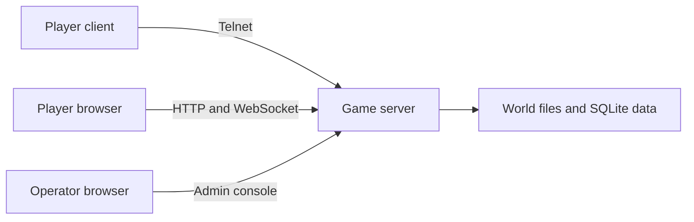

A Dark Pawns host runs the game server, the web client, and the admin console from a single bundle, backed by embedded SQLite. A fresh server starts in under half a second and idles around 85 MiB of RAM. Any spare Linux, macOS, or Windows machine with 1 GiB of memory and 2 GiB of disk can run a world without breaking a sweat.

## What you need

| Requirement | What to expect |
| --- | --- |
| **Operating system** | Signed portable archives ship for Linux, macOS, and Windows on `amd64` and `arm64`. |
| **Memory** | An idle world uses 84 to 88 MiB RSS. Budget at least 1 GiB of RAM to give connected players and updates comfortable headroom. |
| **Disk** | The bundle is under 46 MB (40.2 MB server binary, 5.3 MB world files, 0.4 MB web assets). Budget at least 2 GiB for SQLite player data, logs, backups, and staged releases. |
| **HTTP port** | Defaults to `4350` for both the web client and `/admin/`. |
| **Telnet port** | Defaults to `7777`; set it to `0` to turn off raw telnet. |
| **Public access** | Both listeners bind to `127.0.0.1` by default so you can set up your world in private before opening a firewall or reverse proxy. |

The [portable release guide](https://github.com/zax0rz/darkpawns/blob/main/docs/portable-release.md) covers archive layout and public network exposure in detail.

:::note[Non-commercial license]
Dark Pawns is strictly non-commercial. Under its [DikuMUD and CircleMUD lineage license](https://github.com/zax0rz/darkpawns/blob/main/LICENSE), you cannot charge players fees, accept donations, or take reimbursement for hosting costs under any circumstances.
:::

## What runs where

This diagram shows how players and the operator reach one instance.



The `darkpawns` launcher supervises the game server process. The server serves the web client and admin console from its HTTP port, accepts MUD clients on its telnet port, and writes player state to SQLite. When you're ready for public players, put an HTTPS reverse proxy in front of the HTTP listener and expose the telnet or TLS telnet port you want players to use.

## Follow the setup path

1. [Install Dark Pawns](/docs/host/install/) with the bootstrap command or your package manager.
2. [Create your first world and sign in](/docs/host/first-login/) to claim the level 40 implementor character.
3. Tour [the admin console](/docs/host/admin-console/) and [configuration settings](/docs/host/admin-configuration/).
4. Read [Hosting and adoption](https://github.com/zax0rz/darkpawns/blob/main/docs/portable-hosting.md) before opening your server to the internet.
5. Learn how to [update your server](/docs/host/update-server/) and fix [connection problems](/docs/host/players-cannot-connect/).

For a local Linux or macOS install, the bootstrap command is:

```sh
curl -fsSL https://darkpawns.org/install.sh | bash
```

## How it works

The memory and startup figures above come from an idle Linux `amd64` launch of the bundled world from the repository root: the server answered `/health` in 0.42 seconds, with RSS measured at 83,864 KiB at readiness, 87,972 KiB at 5 seconds, 87,976 KiB at 10 seconds, and 86,856 KiB at 15 seconds with zero connected players. The 1 GiB RAM and 2 GiB disk recommendations provide roughly tenfold headroom over the idle footprint for active play, log retention, and atomic release staging, though busy public worlds or long backup histories will use more.
