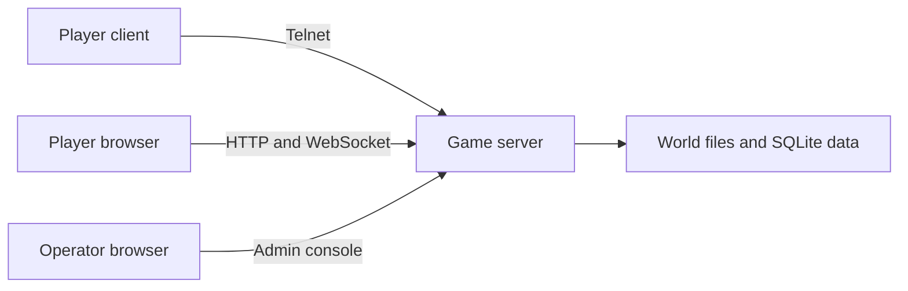

A Dark Pawns host runs the game server and its web and admin interfaces. You supply a machine and decide whether players can reach it from outside that machine. On this Linux amd64 checkout, a fresh idle server reached its health check in 0.42 seconds and used about 84 to 88 MiB of resident memory during the first 15 seconds. That’s one local startup observation, not a production benchmark or a supported minimum.

## What you need

| Requirement | Current release facts |
| --- | --- |
| Operating system | Published portable archives target Linux, macOS, and Windows on amd64 and arm64. |
| Memory | One idle local run used 84 to 88 MiB RSS. For a small test world, budget at least 1 GiB as planning headroom; this is an estimate, not a tested minimum. |
| Disk | The measured server binary was 40.2 MB, the world tree 5.3 MB, and web assets 0.4 MB. For a small test world, budget at least 2 GiB to leave room for data, logs, backups, and updates; this is an estimate, not a tested minimum. |
| HTTP port | The setup default is `4350`. It serves the web client and admin console. |
| Telnet port | The setup default is `7777`; enter `0` to disable it. |
| Public access | Both listeners bind to loopback by default. Public hosting needs an intentional listener and firewall or proxy configuration. |

The current package archives and listener behavior are documented in the [portable release guide](https://github.com/zax0rz/darkpawns/blob/main/docs/portable-release.md). That guide also explains how public hosting changes the network setup.

The sample was a single idle launch from the repository root using its bundled world, on Linux amd64. It reached `/health` in 0.42 seconds; RSS samples were 83,864 KiB at readiness, 87,972 KiB after five seconds, 87,976 KiB after ten, and 86,856 KiB after fifteen. It had no connected players. The planning figures above provide roughly ten times that observed memory and ample room beyond the measured files, but concurrent players, backups, logs, and a production deployment can need more.

## Cost and setup time

If you already have a suitable machine and network, there’s no additional hosting-provider fee; electricity and internet service still have their usual costs. A new machine, network, domain, or optional proxy or monitoring service has a separate provider bill, so check the current terms before choosing one. The game is strictly non-commercial: its license prohibits fees, donations, compensation, and reimbursement of hosting costs. Read the [full license](https://github.com/zax0rz/darkpawns/blob/main/LICENSE) before operating a public instance.

The measured server startup took 0.42 seconds from process launch to health check. End-to-end setup time hasn't been measured, so don't use that startup figure as an install estimate. A local install is one bootstrap command followed by the setup wizard; public access adds listener and firewall choices, possible proxy or TLS setup, and remote checks. The time depends on your machine, network, and how much public-access configuration you need.

## What runs where

This diagram shows how players and the operator reach one instance.



The launcher starts and supervises the game server. The server serves the web client and admin console from its HTTP listener, accepts telnet sessions on the telnet listener, and stores player data in SQLite. A reverse proxy can provide public HTTPS access while the server listener stays on loopback.

## Follow the setup path

1. [Install Dark Pawns](/docs/host/install/) with the bootstrap command or a package method.
2. [Create your first world and sign in](/docs/host/first-login/).
3. Review [configuration settings](/docs/host/admin-configuration/) and [the admin console](/docs/host/admin-console/).
4. Read [Hosting and adoption](https://github.com/zax0rz/darkpawns/blob/main/docs/portable-hosting.md) before exposing a listener publicly.
5. Learn to [update your server](/docs/host/update-server/) and diagnose [connection problems](/docs/host/players-cannot-connect/).

For a local install, the bootstrap command is:

```sh
curl -fsSL https://darkpawns.org/install.sh | bash
```
