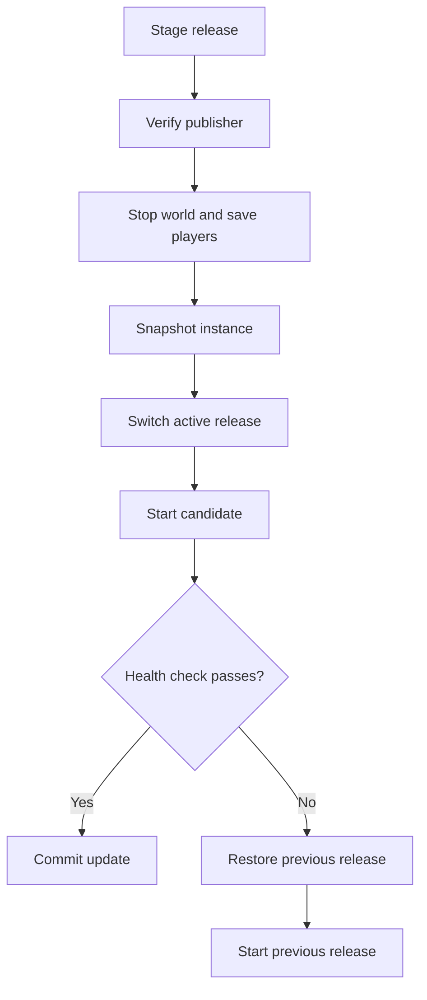

import { Tabs, TabItem, Steps } from '@astrojs/starlight/components';

Update a managed instance with `darkpawns update` or **Admin → Updates**. The launcher stages and verifies a release while the world runs, then restarts into it. If its health check fails, the previous release is restored automatically.

## Before you start

- A managed instance installed with the Dark Pawns launcher.
- Implementor access (level 40) for the admin console.
- A maintenance window if players are online. The world stops during the switch.

## Run the update

<Tabs>
  <TabItem label="Admin console">
    <Steps>

    1. Open **Admin → Updates**.
    2. Choose **Check for updates**.
    3. Review the available release and online players.
    4. Choose **Update now** and confirm.
    5. Return to the page later to read the transaction status. You can close the browser while the update runs.

    </Steps>

    The page reports staging, applying, testing, then committed or rolled back. A browser refresh can resume reading status from the launcher's journal.

    
  </TabItem>
  <TabItem label="Command line">
    <Steps>

    1. Run `darkpawns update` from the instance's launcher environment.
    2. Follow the printed status until the command reports completion or failure.

    </Steps>

    If the machine stopped during an update, run the recovery command printed by the admin console or `darkpawns update recover`.

    
  </TabItem>
</Tabs>

## How rollback works

The diagram shows the launcher's update transaction and its rollback path.

## Did it work?

The status is **Committed**, and the running release shown in **Admin → Updates** matches the release you selected.

## If it didn't work

- **The check finds no release.** The server may already be current. Check the running version on the Updates page.
- **The candidate fails its health check.** The launcher restores the previous release. Read the transaction detail and server log before retrying.
- **The update was interrupted.** Run `darkpawns update recover` as directed by the status page.

## Related

- [Install Dark Pawns](/docs/host/install/)
- [Configuration settings](/docs/host/admin-configuration/)
- [Players can't connect](/docs/host/players-cannot-connect/)
