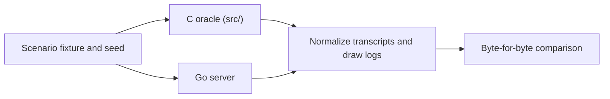

Dark Pawns is a faithful port, not a reinterpretation. The original reachable C path decides game behavior; differential scenarios prove the Go server against it.

## The five rules

The full [Port Rulebook](https://github.com/zax0rz/darkpawns/blob/main/docs/fidelity/RULEBOOK.md) defines:

- **R1:** player-facing bytes are law.
- **R2:** command names, aliases, gates, and positions are part of the game.
- **R3:** random draw counts, time, and operation order must match.
- **R4:** don't invent player-observable behavior.
- **R5:** verify the reachable call path, prove fixes, and audit repeated failure classes.

## Set up the oracle

The complete workstation procedure is maintained in [`docs/DEV-SETUP.md`](https://github.com/zax0rz/darkpawns/blob/main/docs/DEV-SETUP.md). It builds the separate read-only C oracle and points `DP_ORACLE_BIN` at its executable.

## Run a scenario

```bash
DP_ORACLE_BIN=/path/to/darkpawns-c-oracle/bin/circle \
DP_SEED=1 DP_FRESH_MUD=1 \
go run ./cmd/dp-oracle-diff --scenario mortal-batch14
```

Read the reported `result:` line, not only the process exit status; the harness may exit successfully even when it reports a divergence. This command illustrates one scenario, not proof that a command or feature is complete. Random outcomes require validation of underlying rolls or multiple samples, not a single coincidentally matching result.

This diagram shows how a differential scenario compares the C oracle and Go server.



## Preserve the authority boundary

Never edit `src/` or the oracle to make Go pass. A confirmed repeated pattern changes the rulebook and triggers a class-wide audit. A suspected mismatch isn't confirmed until its real call path is shown to be reachable.
