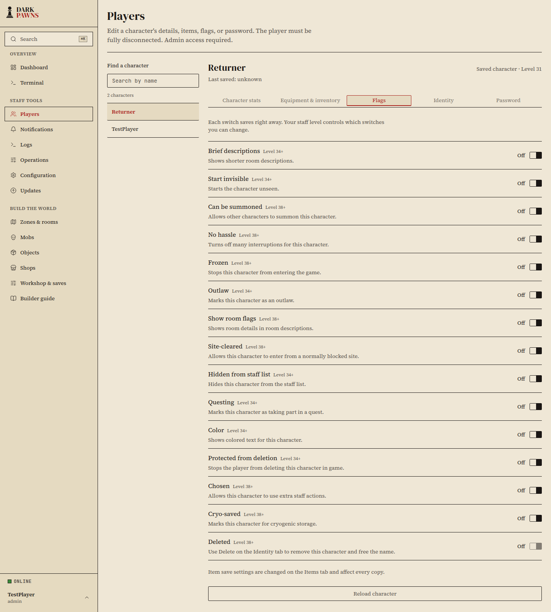
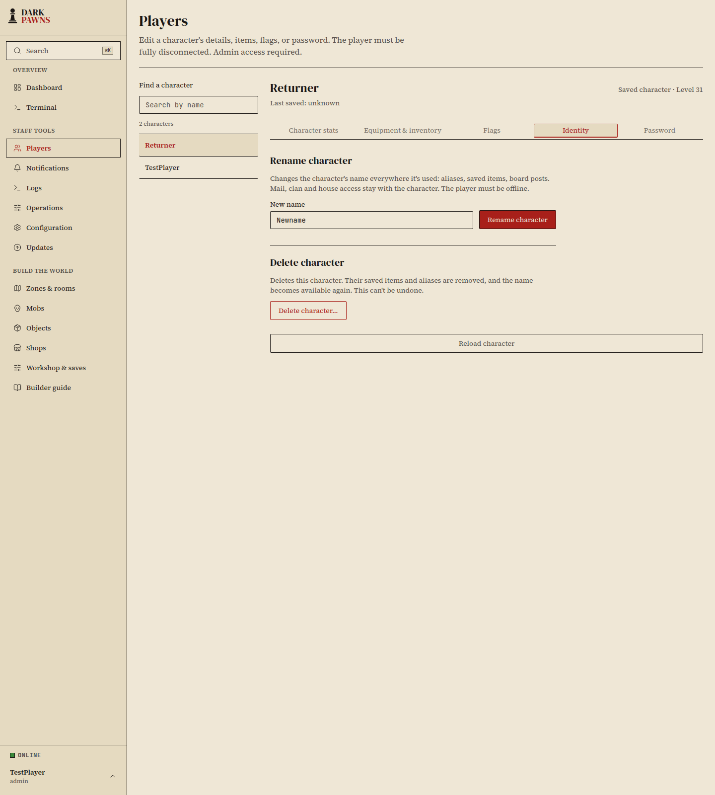
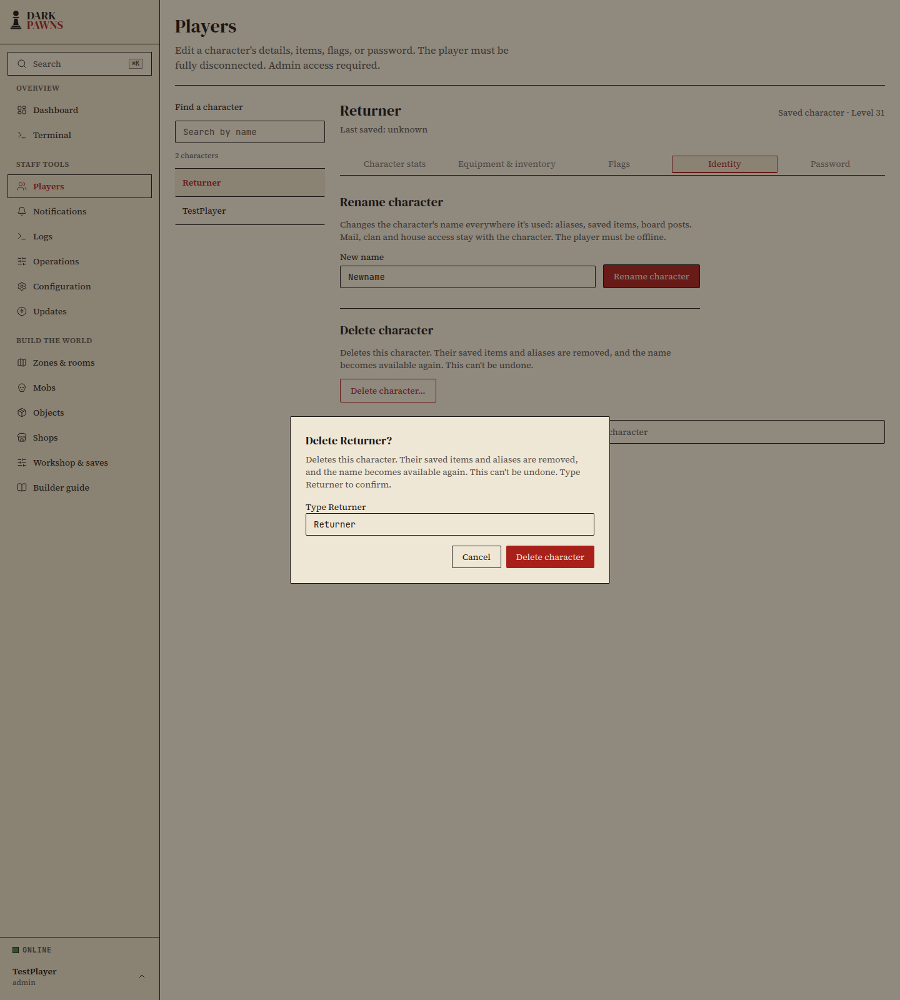

The **Players** page manages saved characters. A character must be fully
disconnected before you can edit it. This includes linkdead characters and
characters at the login screen. The editor refuses online changes so a late
save cannot overwrite them.

## Rename

Open **Players**, choose a character, and select **Identity**. Enter a new name
that follows the character creation rules. Names already in use, reserved for
staff, or blocked by the invalid-name list are rejected.

The player must be offline, including from linkdead sessions and the login
screen. The rename changes the name throughout the character's saved records
and board posts. Mail, clan membership, and house access stay with the same
character.

## Delete

Choose **Delete character…** on the **Identity** tab and review the confirmation.
For characters at level 31 or higher, type the character's name to confirm.
You cannot delete your own character or a level 40 character. The delete action
works at every other level, including for frozen characters. The character must
be fully disconnected.

Deletes this character. Their saved items and aliases are removed, and the name
becomes available again. This can't be undone.

Old mail and house access stay with the old character. Clan membership is
cleared, and old board posts remain as history. A new character using the same
name starts fresh and does not inherit the old mail or house.

## Flags

Open **Flags** to turn character switches on or off. Each switch saves right
away, and the level shown beside it is the minimum staff level needed to change
it. The **Deleted** status is read-only; use **Delete** on the **Identity** tab
to remove a character.

The **Cryo-saved** switch changes the character's cryo marker only. It does not
store or restore saved items. An item's **Kept after logout** setting is shared
by every copy; choose **Change setting for all copies** to edit it.

## Screenshots

These screenshots use the synthetic local preview character `Returner`.

## How it works

The table records whether each store follows the character's name or its stable
ID, and what the admin actions change.

| Store | Identity | Rename | Admin delete |
| --- | --- | --- | --- |
| Character record | Case-insensitive name plus stable numeric ID | Updates the record key and embedded character name in one SQLite transaction; preserves the ID. | Keeps the record for name reuse, marks it deleted, clears saved inventory and equipment, and frees the name for a new ID. |
| Saved items | Lowercase character name in `object_saves` | Moves the save key in the same SQLite transaction. | Removes the saved item record in the same SQLite transaction. |
| Aliases | Name-keyed file under `data/aliases/` | Moves the file using a durable rename journal; startup recovery restores an interrupted change. | Removes the alias file after the database transaction. |
| Active moderation penalties | Lowercase `player_name` key | Moves the database and in-memory keys with the character. | Leaves penalty history under the old name. |
| Mail sender and recipient | Numeric character IDs in C mail headers; the Go server also caches ID-to-name lookups | Keeps the IDs and refreshes the name cache after commit. | Keeps mail under the old ID; a new character with the same name gets a new ID and does not inherit it. |
| Clan members and applicants | `clan_id` and `clan_rank` in character data; rank zero is an applicant | Keeps the character's clan membership. | Clears the character's clan fields and updates clan totals, including when the clan is first in the list. |
| House owners and guests | Numeric character IDs | Keeps house ownership and guest access with the same ID. | Leaves ownership, guests, and house contents attached to the old ID. |
| Board posts | Author name in each saved heading | Updates the exact author name and preserves the date and message. | Leaves old posts as history. |
| Login sessions and linkdead state | In-memory names and ID-backed session ownership | Reserves both names and refuses while either is connected, entering, switched, or linkdead. No session is saved or disconnected by the editor. | Refuses while the character is connected or entering. |
| Login failure limits | Normalized name in memory and persistent counters in the character record | Carries the stricter in-memory failure limit to the new name; persistent counters move with the record. | Keeps the old ID's counters with the retained record. |
| Invalid-name list and staff-reserved names | Name or blocked substring | Checks the new name against the same syntax, reserved-name, and invalid-name rules used at character creation. | Leaves the name lists unchanged. |
| Site bans | Host or address; issuer name is historical text | Leaves the ban and its recorded issuer unchanged. | Leaves the ban unchanged. |
| Decision logs, reports, and admin audit | Historical name text | Keeps the names recorded when each event occurred. | Keeps the history and records the admin delete action. No separate character decision-log store was found. |

The rename's SQLite updates cover the character record, saved-item key, active
moderation key, and persistent login counters. Board headings and aliases use a
recovery journal so a failed or interrupted rename can be restored before the
admin router accepts requests. Mail and houses use the stable ID, while board
headings and historical audit text store names directly.

The in-game self-delete flow remains unchanged. In the C source, it refuses
frozen characters, leaves the deleted marker clear at level 38 and above, and
only clears clan membership when the clan is found after the first table entry.
The admin delete action is a separate Go-only operator tool: it marks every
eligible target deleted and clears clan membership at any table position.

These details follow the C call paths: character creation checks name length,
validity, fill words, and reserved words in
[`src/interpreter.c:1755`](https://github.com/zax0rz/darkpawns/blob/4fb40c8f0ce2fc28c467680d0dc313abb8d73747/src/interpreter.c#L1755)
and checks the invalid-name list in
[`src/ban.c:257`](https://github.com/zax0rz/darkpawns/blob/4fb40c8f0ce2fc28c467680d0dc313abb8d73747/src/ban.c#L257); in-game
self-delete is in
[`src/interpreter.c:2321`](https://github.com/zax0rz/darkpawns/blob/4fb40c8f0ce2fc28c467680d0dc313abb8d73747/src/interpreter.c#L2321); saved
crash items and aliases are removed by
[`src/objsave.c:151`](https://github.com/zax0rz/darkpawns/blob/4fb40c8f0ce2fc28c467680d0dc313abb8d73747/src/objsave.c#L151)
and
[`src/objsave.c:1227`](https://github.com/zax0rz/darkpawns/blob/4fb40c8f0ce2fc28c467680d0dc313abb8d73747/src/objsave.c#L1227). Mail stores sender and
recipient IDs in
[`src/mail.h:84`](https://github.com/zax0rz/darkpawns/blob/4fb40c8f0ce2fc28c467680d0dc313abb8d73747/src/mail.h#L84)
and resolves names for display in
[`src/mail.c:432`](https://github.com/zax0rz/darkpawns/blob/4fb40c8f0ce2fc28c467680d0dc313abb8d73747/src/mail.c#L432). House ownership and guests
are IDs in
[`src/house.h:31`](https://github.com/zax0rz/darkpawns/blob/4fb40c8f0ce2fc28c467680d0dc313abb8d73747/src/house.h#L31), and board headings store
the author's name in
[`src/boards.c:248`](https://github.com/zax0rz/darkpawns/blob/4fb40c8f0ce2fc28c467680d0dc313abb8d73747/src/boards.c#L248).
